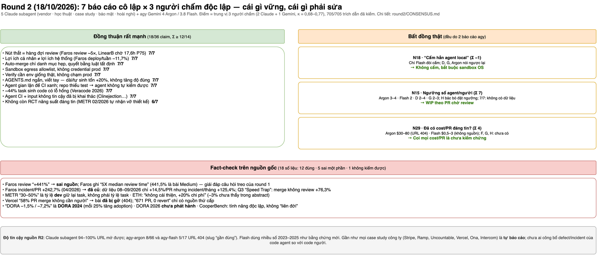

# Software Factory Research

Research về quy trình phát triển phần mềm cho team làm việc cùng nhiều AI coding agent.
Thực hiện ngày 2026-10-13: 5 agent research song song trên cùng một bộ câu hỏi, cộng 13 video YouTube (agy đọc transcript; video 14 thêm ngày 2026-10-23), sau đó chấm đồng thuận và gộp.

| File | Nội dung |
|---|---|
| [REPORT.md](REPORT.md) | **Báo cáo tổng hợp**: quy trình 8 bước, vai trò, kiến trúc điều phối, rủi ro, lộ trình 3 tháng |
| [CONSENSUS.md](CONSENSUS.md) | Phần A: 26 claim × 5 báo cáo research (TF-IDF, kiểm tra URL, outlier). Phần B: 26 claim × 14 video, độ khớp Claude–agy (κ=0,44), 26 claim mới V1–V26 |
| [video-youtube/](video-youtube/) | 14 phân tích video (agy, dựa trên transcript), transcript, script |
| [diagrams/](diagrams/) | **Sơ đồ draw.io** `software-factory.drawio` (4 trang) + ảnh PNG; sinh bằng `build_drawio.py` |
| [BRIEF.md](BRIEF.md) | Bộ câu hỏi chung (Q1–Q4) giao cho cả 5 agent |
| [raw/](raw/) | 4 báo cáo research gốc: `claude-{A-vendor,B-academic,C-practitioner}.md`, `agy-gemini-flash.md` (báo cáo gpt-oss đã bị loại và xoá, lý do ở CONSENSUS) |
| [scoring/](scoring/) | `claims.json`, `consensus.json` (điểm + trích dẫn), `lexical.json`, `url-check.txt` (kết quả HTTP của mọi URL nguồn), `video-consensus-{a,b,c}.json`, `video-agy-scores.json`, `video-merged.json`, `video-claims.json`, `merge_video.py`, `render_partB.py` |

## Template tài liệu

[templates/](templates/) là bộ template tài liệu tối thiểu cho team 3–10 kỹ sư làm việc cùng AI agent, gồm:
README, AGENTS.md cùng CLAUDE.md, kiến trúc, ADR (MADR 4), API (OpenAPI 3.1 + RFC 9457), spec, chiến lược test, PR template có DoD,
runbook và postmortem, SECURITY.md, chính sách dùng AI, CONTRIBUTING, glossary và CHANGELOG.
Cách dùng: copy `templates/project/.` vào repo dự án rồi điền vào.

Template được chọn bằng **round 3** ([round3/CONSENSUS.md](round3/CONSENSUS.md)):
- 6 báo cáo research cô lập (4 Claude subagent theo 4 lăng kính, 2 `agy` Gemini);
- 3 người chấm độc lập, κ = 0,74–0,86, chấm 83 claim, 1.334/1.334 trích dẫn đã kiểm;
- mỗi lựa chọn trong template ghi mức đồng thuận A/B/C.

| File round 3 | Nội dung |
|---|---|
| [round3/BRIEF-R3.md](round3/BRIEF-R3.md) | Bộ câu hỏi D1–D11 |
| [round3/raw/](round3/raw/) | 6 báo cáo gốc |
| [round3/scoring/](round3/scoring/) | `claims.json`, `rater-{a,b,agy}.json`, `consensus.json`, `url-status.tsv`, `lexical.json`, các script |

## Round 2 (2026-10-18)

Round 2 đào sâu bằng chứng 04–10/2026, case study công ty và ba điểm còn tranh cãi của round 1
(auto-merge, mức song song, chạy agent local hay sandbox). Cách chạy:
- 7 agent research song song, cô lập nhau: 5 Claude subagent với 5 lăng kính (vendor, học thuật,
  case study, bảo mật, hoài nghi), cộng `agy` Gemini 4 Argon và Gemini 3.8 Flash.
- 3 người chấm độc lập (2 Claude và 1 Gemini, κ = 0,68–0,77).
- Kiểm chứng 18 số liệu then chốt trên nguồn gốc.

| File | Nội dung |
|---|---|
| [round2/REPORT.md](round2/REPORT.md) | **Báo cáo round 2**: 8 điểm mới, đối chiếu với round 1, kết luận 3 điểm tranh cãi, checklist bảo mật từ các sự cố 2026, các chỉnh sửa cho quy trình 8 bước và lộ trình 3 tháng |
| [round2/CONSENSUS.md](round2/CONSENSUS.md) | 36 claim × 7 báo cáo (trung vị của 3 người chấm), độ tin cậy giữa người chấm, tương đồng văn bản, bảng kiểm chứng số liệu, outlier |
| [round2/BRIEF-R2.md](round2/BRIEF-R2.md) | Bộ câu hỏi R1–R8 |
| [round2/raw/](round2/raw/) | 7 báo cáo gốc |
| [round2/scoring/](round2/scoring/) | `claims.json`, `rater-{a,b,agy}.json`, `consensus.json`, `fact-check.md`, `urls.tsv` / `url-status.tsv`, `lexical.json`, các script `merge.py`, `render.py`, `lexical.py` |

```bash
python3 round2/scoring/merge.py    # kiểm tra trích dẫn, κ giữa người chấm, trung vị → consensus.json
python3 round2/scoring/render.py   # in bảng ma trận Markdown
python3 round2/scoring/lexical.py  # TF-IDF cosine + Jaccard domain
```

## Chạy lại

```bash
# agy (không dùng --dangerously-skip-permissions; cấm shell/background task trong prompt)
agy -p "<prompt + BRIEF.md>" --model gemini-3.8-flash-high --output-format json --print-timeout 1500s \
  | python3 -c "import json,sys;print(json.load(sys.stdin)['response'])" > raw/agy-gemini-flash.md
```

Xem danh sách model khả dụng: `agy models`. `gemini-3.1-pro-high` đã không còn, nên lần chạy này
dùng `gpt-oss-120b-medium` thay thế.

## Sơ đồ

Mở `diagrams/software-factory.drawio` bằng draw.io (desktop hoặc app.diagrams.net). Sơ đồ đã cập nhật theo round 2 (18/10/2026); mục round 2 được đánh dấu **R2** màu tím. Muốn sửa nội dung thì sửa
`diagrams/build_drawio.py` rồi chạy lại `python3 diagrams/build_drawio.py`. Xuất PNG bằng lệnh
`drawio -x -f png -p <trang 1..5> -o out.png diagrams/software-factory.drawio`.

| Trang | Nội dung |
|---|---|
| 1 | Quy trình 8 bước, chia làn Người / AI agent / Code tất định, có 2 gate, các vòng sửa lỗi và làn auto-approve (R2) |
| 2 | Kiến trúc: control plane (code tất định) và data plane (agent trong sandbox), đường đi của PR, khép vòng production |
| 3 | Lộ trình 3 tháng, tiêu chí thoát từng giai đoạn, rủi ro, công cụ tối thiểu, tín hiệu dừng mở rộng (R2) |
| 4 | Bản đồ đồng thuận research × video và 3 điểm căng, kèm kết luận round 2 |
| 5 | Round 2: đồng thuận 7 báo cáo × 3 người chấm, bất đồng thật, kết quả fact-check |




## License

[MIT](LICENSE). Bản tóm tắt video trích dẫn ngắn lời của các tác giả video gốc (link YouTube trong từng file); bản quyền nội dung video thuộc về họ.
