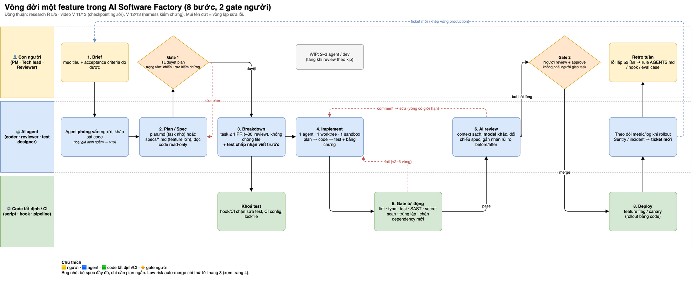
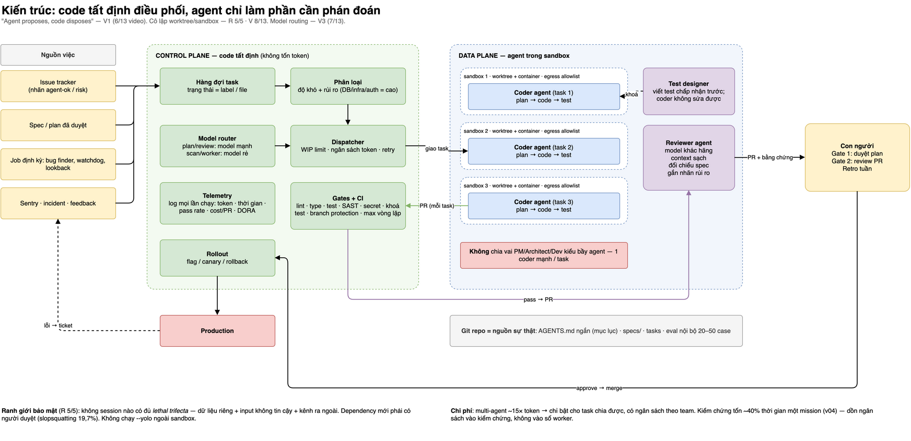
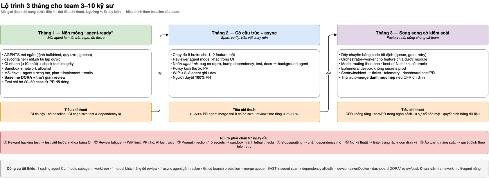
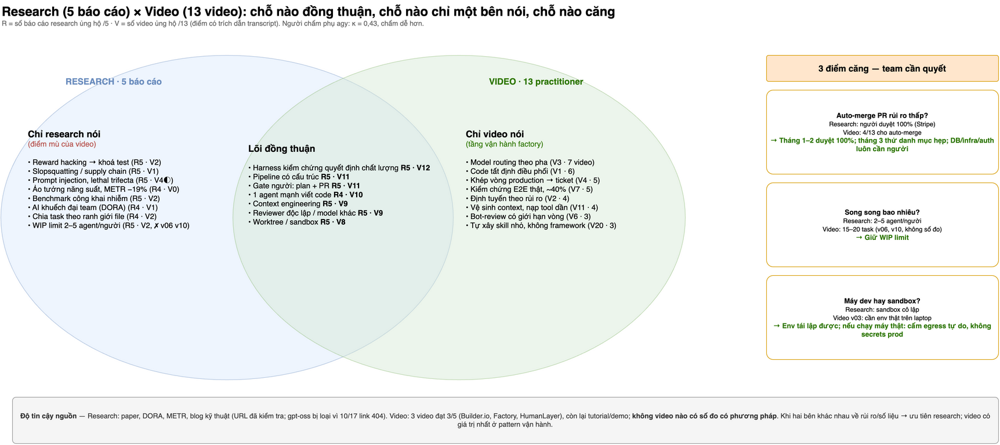

# Software Factory Research

Research về quy trình phát triển phần mềm cho team làm việc cùng nhiều AI coding agent.
Thực hiện ngày 2026-10-13: 5 agent research song song trên cùng một bộ câu hỏi, cộng 13 video YouTube (agy đọc transcript), sau đó chấm đồng thuận và gộp.

| File | Nội dung |
|---|---|
| [REPORT.md](REPORT.md) | **Báo cáo tổng hợp**: quy trình 8 bước, vai trò, kiến trúc điều phối, rủi ro, lộ trình 3 tháng |
| [CONSENSUS.md](CONSENSUS.md) | Phần A: 26 claim × 5 báo cáo research (TF-IDF, kiểm tra URL, outlier). Phần B: 26 claim × 13 video, độ khớp Claude–agy (κ=0,43), 22 claim mới V1–V22 |
| [video-youtube/](video-youtube/) | 13 phân tích video (agy, dựa trên transcript), transcript, script |
| [diagrams/](diagrams/) | **Sơ đồ draw.io** `software-factory.drawio` (4 trang) + ảnh PNG; sinh bằng `build_drawio.py` |
| [BRIEF.md](BRIEF.md) | Bộ câu hỏi chung (Q1–Q4) giao cho cả 5 agent |
| [raw/](raw/) | 4 báo cáo research gốc: `claude-{A-vendor,B-academic,C-practitioner}.md`, `agy-gemini-flash.md` (báo cáo gpt-oss đã bị loại và xoá, lý do ở CONSENSUS) |
| [scoring/](scoring/) | `claims.json`, `consensus.json` (điểm + trích dẫn), `lexical.json`, `url-check.txt` (kết quả HTTP của mọi URL nguồn), `video-consensus-{a,b,c}.json`, `video-agy-scores.json`, `video-merged.json`, `video-claims.json`, `merge_video.py`, `render_partB.py` |

## Chạy lại

```bash
# agy (không dùng --dangerously-skip-permissions; cấm shell/background task trong prompt)
agy -p "<prompt + BRIEF.md>" --model gemini-3.8-flash-high --output-format json --print-timeout 1500s \
  | python3 -c "import json,sys;print(json.load(sys.stdin)['response'])" > raw/agy-gemini-flash.md
```

Xem danh sách model khả dụng: `agy models`. `gemini-3.1-pro-high` đã không còn, nên lần chạy này
dùng `gpt-oss-120b-medium` thay thế.

## Sơ đồ

Mở `diagrams/software-factory.drawio` bằng draw.io (desktop hoặc app.diagrams.net). Muốn sửa nội dung thì sửa
`diagrams/build_drawio.py` rồi chạy lại `python3 diagrams/build_drawio.py`. Xuất PNG bằng lệnh
`drawio -x -f png -p <trang 1..4> -o out.png diagrams/software-factory.drawio`.

| Trang | Nội dung |
|---|---|
| 1 | Quy trình 8 bước, chia làn Người / AI agent / Code tất định, có 2 gate và các vòng sửa lỗi |
| 2 | Kiến trúc: control plane (code tất định) và data plane (agent trong sandbox), đường đi của PR, khép vòng production |
| 3 | Lộ trình 3 tháng, tiêu chí thoát từng giai đoạn, rủi ro, công cụ tối thiểu |
| 4 | Bản đồ đồng thuận research × video và 3 điểm căng |






## License

[MIT](LICENSE). Bản tóm tắt video trích dẫn ngắn lời của các tác giả video gốc (link YouTube trong từng file); bản quyền nội dung video thuộc về họ.
