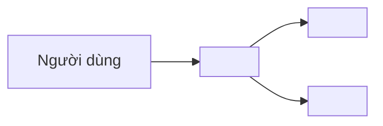
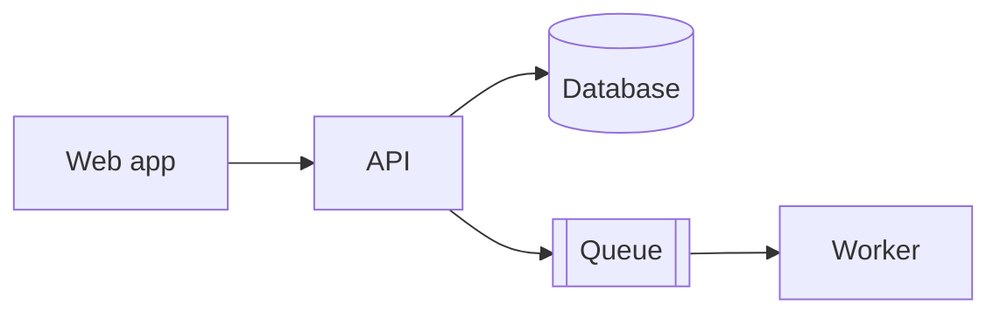

<!-- Nền: arc42 rút gọn + phần codemap/invariants của matklad ARCHITECTURE.md + sơ đồ C4 mức 1–2 (round 3: H3–H6).
     Hai phương án nền hoà nhau 3–3 trong round 3; template này ghép cả hai. Các ý được cả 6 báo cáo đồng ý:
     sơ đồ dạng code, không điền đủ 12 mục arc42, không vẽ C4 mức Component/Code bằng tay, có crosscutting và invariants.
     Dài 2–5 trang. Chỉ ghi những gì ÍT thay đổi; xem lại vài lần mỗi năm.
     Tài liệu này cho NGƯỜI; AGENTS.md chỉ link tới đây, không chép vào. -->
# Kiến trúc <Tên hệ thống>

Cập nhật lần cuối: <YYYY-MM-DD> · Owner: <tên>

## 1. Mục tiêu và ràng buộc

- **Bài toán:** <1–2 câu, cho ai>
- **Top 3 mục tiêu chất lượng:** <ví dụ: p95 < 300ms · 99.9% uptime · dễ thay đổi luật tính phí>
- **Ràng buộc:** <ví dụ: dữ liệu khách hàng lưu tại Việt Nam; phải chạy trên <cloud>; tuân thủ <...>>

## 2. Bối cảnh (C4 mức 1)

## 3. Thành phần (C4 mức 2)

| Thành phần | Công nghệ | Trách nhiệm | Owner |
|---|---|---|---|
| <API> | <...> | <...> | <...> |

## 4. Chiến lược giải pháp

<!-- 5–10 gạch đầu dòng: các lựa chọn nền tảng và lý do ngắn; chi tiết nằm trong ADR. -->
- <ví dụ: monolith modular thay vì microservice: team 5 người, một lần deploy (ADR-0001)>

## 5. Codemap (tuỳ chọn)

<!-- Module nào lo việc gì, tìm ở đâu. Gọi TÊN module/symbol thay vì link (link dễ hỏng). -->
| Module | Trách nhiệm |
|---|---|
| `<billing>` | <...> |

## 6. Bất biến, ranh giới và concept xuyên suốt

<!-- Phần agent hay vi phạm nhất. Viết dạng quy tắc kiểm chứng được; tốt nhất có lint hoặc test kiến trúc đi kèm. -->
- **Bất biến:** <ví dụ: module `orders` không bao giờ import `billing.internal`>
- **Auth:** <cơ chế, nơi kiểm tra quyền>
- **Logging / tracing:** <chuẩn log, correlation id>
- **Xử lý lỗi:** <ví dụ: lỗi API theo RFC 9457, xem docs/api/>
- **Dữ liệu nhạy cảm:** <PII nằm ở đâu, ai được đọc>

## 7. Môi trường triển khai (tuỳ chọn)

| Môi trường | Deploy bằng | Ghi chú |
|---|---|---|
| dev / preview | <...> | Agent chỉ được dùng môi trường này |
| production | <...> | Agent không có credential |

## 8. Rủi ro và nợ kỹ thuật

- <...>

## 9. Quyết định

Xem [ADR](adr/). ADR đang hiệu lực: <ADR-0001 ...>, <ADR-0002 ...>.
